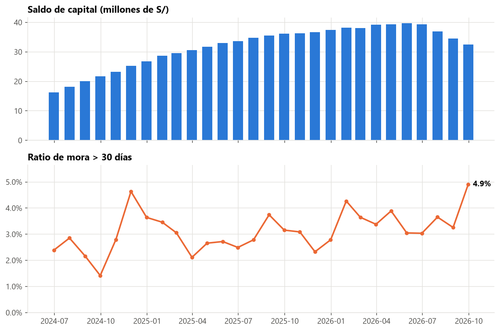
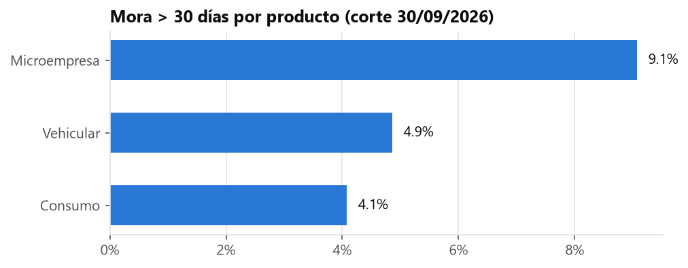
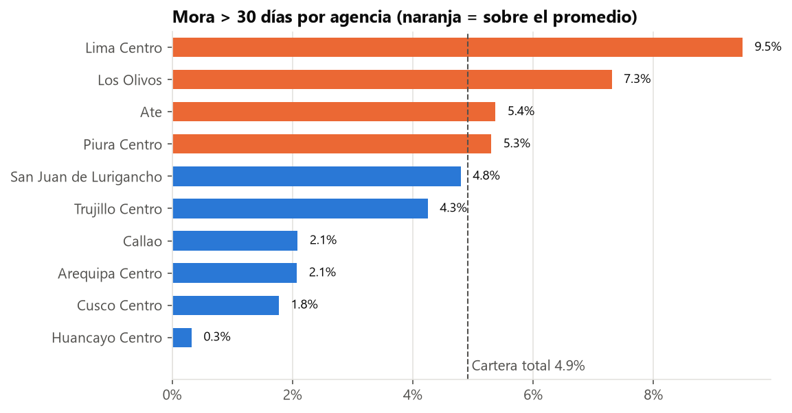
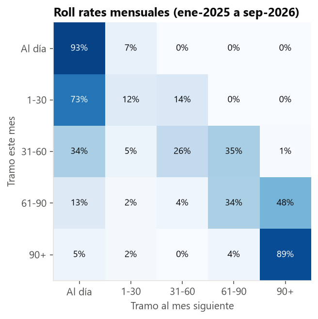
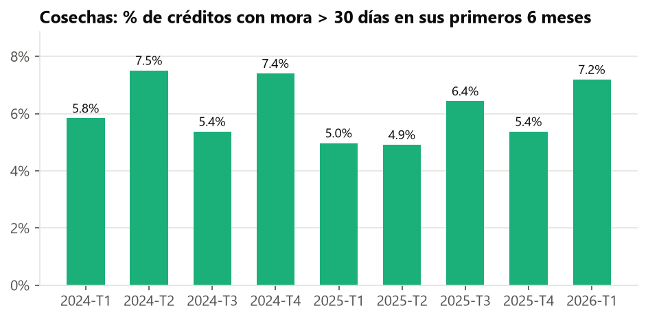
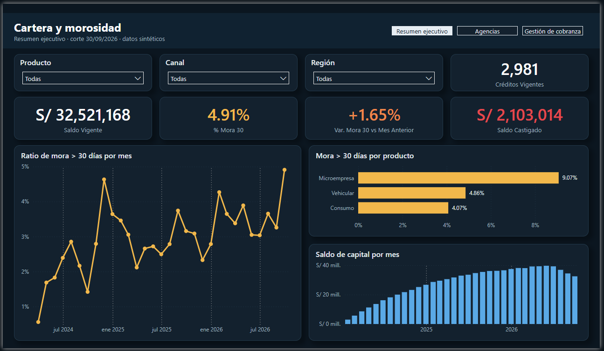
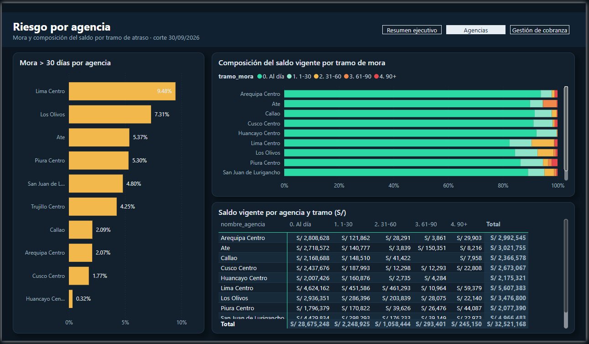
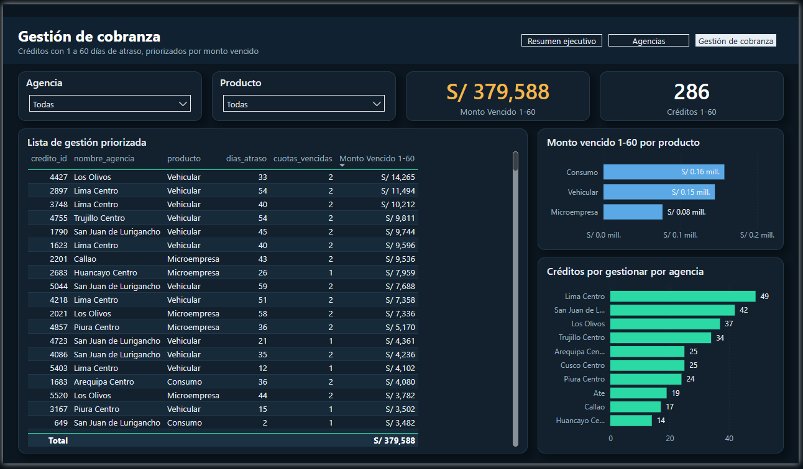

# Análisis de cartera y morosidad · Créditos y cobranzas


Análisis de una cartera de **5 562 créditos** (consumo, microempresa y vehicular) de una entidad financiera
ficticia con 10 agencias en el Perú: medición de la mora, migración entre tramos de atraso (*roll rates*),
calidad por cosecha y priorización de la cobranza temprana.

> ⚠️ **Datos 100 % sintéticos.** Se generaron con una simulación propia ([`scripts/generar_datos.py`](scripts/generar_datos.py)).
> No corresponden a ninguna persona ni entidad real.

---

## 1. Problema de negocio

La gerencia de riesgos necesita responder, al cierre del **30/09/2026**:

1. ¿Cuál es el nivel de mora de la cartera y cómo evolucionó?
2. ¿Qué productos, canales y agencias concentran el riesgo?
3. ¿Qué tan probable es que un crédito atrasado siga empeorando (*roll rate*)?
4. ¿Qué créditos debe priorizar hoy el equipo de cobranza temprana?

## 2. Datos

| Tabla | Filas | Contenido |
|---|---:|---|
| `agencias` | 10 | Agencia y región |
| `clientes` | 4 000 | Edad, sexo, tipo de empleo, ingreso mensual |
| `creditos` | 5 562 | Producto, canal, monto, plazo, TEA, cuota, fecha de castigo |
| `cuotas` | 115 518 | Cronograma (método francés) con fecha de vencimiento y fecha de pago |

**Cómo se simularon:** cada mes el cliente paga, se atrasa o se pone al día, con una probabilidad que depende de
su perfil (ingreso, edad, carga cuota/ingreso, producto, canal, agencia y un rasgo personal no observable).
Con unos 180 días de atraso el crédito se **castiga**. Se desembolsó entre ene-2024 y jun-2026 por **S/ 86,1 millones**.

```
agencias (1) ──< (N) clientes (1) ──< (N) creditos (1) ──< (N) cuotas
```

## 3. Método

| Paso | Archivo | Técnicas |
|---|---|---|
| Modelo relacional con PK, FK, CHECK e índices | [`sql/01_esquema.sql`](sql/01_esquema.sql) | DDL |
| Carga masiva de CSV | [`sql/02_carga.sql`](sql/02_carga.sql) | `\copy` |
| Foto al corte y **cierres mensuales** (33 meses, 76 mil filas) | [`sql/03_vistas.sql`](sql/03_vistas.sql) | CTE, `FILTER`, `CASE`, `generate_series`, vista materializada |
| Indicadores, roll rates, cosechas, ranking, lista de cobranza | [`sql/04_analisis.sql`](sql/04_analisis.sql) | `LAG`, `RANK`, `NTILE`, `ROW_NUMBER`, `SUM() OVER ()`, `AGE` |
| Gráficos y exportación para BI | [`scripts/graficos_y_exportacion.py`](scripts/graficos_y_exportacion.py) | pandas, matplotlib |
| Dashboard de Power BI (3 páginas: resumen, agencias y cobranza) | [`powerbi/CarteraMorosidad.pbip`](powerbi/) · [guía](powerbi/GUIA_POWERBI.md) | Power Query desde GitHub, modelo estrella, DAX (`CALCULATE`, `DATEADD`, `VAR`) |

**Definiciones clave**
- **Días de atraso:** fecha de corte − vencimiento de la cuota impaga más antigua.
- **Ratio de mora > 30:** saldo de capital de créditos con más de 30 días de atraso ÷ saldo de capital vigente (sin castigados).
- **Roll rate:** % de créditos que pasan de un tramo de atraso a otro de un mes al siguiente.
- **Cosecha (vintage):** créditos agrupados por trimestre de desembolso y comparados a la misma antigüedad (6 meses).

## 4. Resultados

### Indicadores al 30/09/2026

| Indicador | Valor |
|---|---:|
| Saldo de capital vigente | **S/ 32,5 millones** (2 981 créditos) |
| Ratio de mora > 30 días | **4,91 %** |
| Ratio de mora > 90 días | **0,75 %** |
| Créditos castigados (acumulado) | 94 · S/ 2,1 millones de capital |
| Monto vencido recuperable (1–60 días) | S/ 379 588 en 286 créditos |



### ¿Dónde está el riesgo?

| Microempresa | Vehicular | Consumo | Canal digital | Canal agencia |
|---:|---:|---:|---:|---:|
| **9,07 %** | 4,86 % | 4,07 % | **5,66 %** | 4,46 % |




### Roll rates: la ventana de recuperación es corta



- De los créditos con **1–30 días**, el **73,5 % se regulariza** al mes siguiente.
- En **31–60 días** solo se regulariza el 33,7 %, y el **34,6 % pasa a 61–90**.
- En **61–90 días**, el **47,6 % cae a 90+**, donde casi no hay recuperación (4,9 % vuelve a estar al día).

### Cosechas



Entre el 4,9 % y el 7,5 % de cada cosecha cae en mora > 30 en sus primeros 6 meses. **No se observa una tendencia
sostenida de deterioro** en la originación: las diferencias entre trimestres son pequeñas para el tamaño de cada cosecha (~550 créditos).

## 5. Hallazgos y recomendaciones

1. **Concentrar la cobranza en 1–60 días.** Es el tramo donde la gestión todavía cambia el resultado. La consulta P6 genera
   una lista diaria de los 5 casos prioritarios por agencia (S/ 379 588 vencidos en 286 créditos).
2. **Revisar la originación de microempresa**: su mora más que duplica la de consumo.
3. **Auditar Lima Centro y Los Olivos**, con 9,5 % y 7,3 % de mora, frente al 4,9 % de toda la cartera.
4. **Ajustar la política del canal digital**, que tiene 1,2 puntos más de mora que el canal de agencia.
5. **Leer la mora junto con el saldo.** Desde jul-2026 la cartera se reduce porque ya no hay nuevos desembolsos, y el ratio
   sube en parte por **efecto denominador**: la misma mora pesa más sobre un saldo menor.

### Dashboard de Power BI

El dashboard está en formato **PBIP** (Power BI Project), archivos de texto versionables generados con
[`scripts/generar_pbip.py`](scripts/generar_pbip.py). Para abrirlo:

1. Descarga o clona el repositorio y abre `powerbi/CarteraMorosidad.pbip` con Power BI Desktop.
2. Pulsa **Inicio → Actualizar**: Power Query descarga los CSV directamente desde este repositorio.

Diseño: tema propio ([`powerbi/tema_cartera_riesgo.json`](powerbi/tema_cartera_riesgo.json)) con lienzo oscuro, tarjetas con sombra,
navegación entre páginas, KPIs con variación mensual y colores semánticos (verde sano · ámbar alerta · rojo crítico).

**Resumen ejecutivo**: KPIs, evolución de la mora y del saldo, mora por producto y segmentadores.



**Agencias**: ranking de mora, composición del saldo por tramo de atraso y matriz agencia × tramo.



**Gestión de cobranza**: lista priorizada de créditos con 1 a 60 días de atraso.



## 6. Cómo reproducirlo

```bash
python -m pip install -r requirements.txt
python scripts/generar_datos.py                     # crea los CSV en data/
psql -U postgres -c "CREATE DATABASE cartera;"
psql -U postgres -d cartera -f sql/01_esquema.sql
psql -U postgres -d cartera -f sql/02_carga.sql
psql -U postgres -d cartera -f sql/03_vistas.sql
psql -U postgres -d cartera -f sql/04_analisis.sql
python scripts/graficos_y_exportacion.py            # requiere PGPASSWORD en el entorno
```

## 7. Estructura

```
├── data/          CSV sintéticos (agencias, clientes, creditos, cuotas)
├── scripts/       Generación de datos, gráficos y exportación
├── sql/           Esquema, carga, vistas y análisis
├── powerbi/       Datos para el dashboard y guía de construcción
└── img/           Gráficos del README
```

## 8. Lecciones aprendidas

- Definir bien **"cuota vencida"** cambia los números: una cuota que vence el mismo día del corte todavía no está atrasada.
  En una primera versión, esa diferencia movía decenas de créditos al tramo equivocado.
- Una simulación debe seguir corriendo **después del plazo** del crédito: si no, los deudores de las últimas cuotas
  quedan "congelados" en mora y nunca se castigan.
- Las **funciones de ventana** (`LAG`, `ROW_NUMBER`) resuelven en una sola consulta lo que con subconsultas
  requeriría varias pasadas: roll rates y "top N por grupo".
- La **vista materializada** de cierres mensuales evita recalcular 33 meses de historia en cada consulta.

---

**Autor:** Julio García Jara · Estudiante de Ingeniería de Sistemas de Información (UPC) ·
[Portafolio](https://ego4men.github.io/Portafolio-Julio/) · [GitHub](https://github.com/ego4men)
